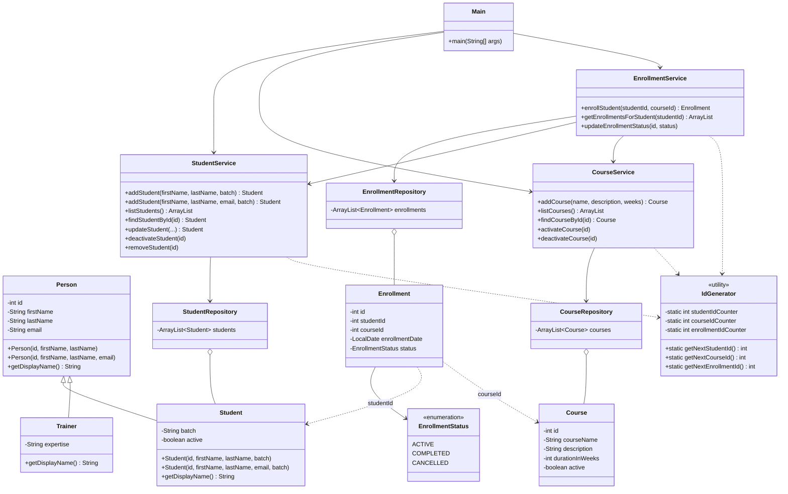

# LearnTrack — Student & Course Management System

LearnTrack is a menu-driven console application written in Core Java. An admin can manage **students**, **courses** and **enrollments**. All data is kept in memory using `ArrayList`.

## Features

**Student management:** add (with or without email), view all, search by ID, update, deactivate, remove.
**Course management:** add, view all, activate, deactivate.
**Enrollment management:** enroll a student in a course, view a student's enrollments, mark completed, cancel.

Invalid input (letters instead of numbers, unknown menu options, IDs that don't exist, blank names, bad emails) shows a clear error message instead of crashing.

## Requirements

- JDK 17 or later (developed with Temurin JDK 21)

## How to compile and run

From the `LearnTrack` folder:

```bash
javac -d bin $(find src -name "*.java")
java -cp bin com.airtribe.learntrack.Main
```

On Windows (PowerShell):

```powershell
javac -d bin (Get-ChildItem -Recurse src -Filter *.java).FullName
java -cp bin com.airtribe.learntrack.Main
```

In an IDE, open the `LearnTrack` folder and run `Main.java`.

## Project structure

```
src/com/airtribe/learntrack/
├── Main.java                  Console menus: reads input, calls services
├── entity/                    Person, Student, Trainer, Course, Enrollment
├── repository/                In-memory ArrayList storage
├── service/                   Business rules
├── exception/                 EntityNotFoundException, InvalidInputException
├── util/                      IdGenerator, InputValidator
├── constants/                 MenuOptions, AppConstants
└── enums/                     EnrollmentStatus
docs/
├── Setup_Instructions.md
├── JVM_Basics.md
└── Design_Notes.md
```

## Class diagram



## Documentation

- [Setup instructions](docs/Setup_Instructions.md)
- [JVM basics](docs/JVM_Basics.md)
- [Design notes](docs/Design_Notes.md)
